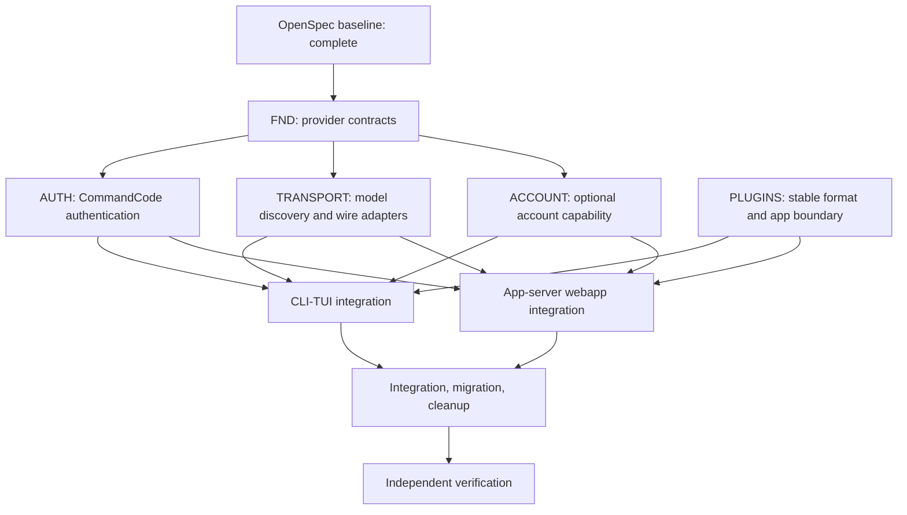

# Implementation Plan: Barebones Direct CommandCode Runtime

## 1. Execution Model

The work is divided into small, reviewable Rust changes with explicit interface ownership. One orchestrator owns sequencing, OpenSpec task state, integration branches, and final verification. Subagents implement bounded slices in isolated worktrees or non-overlapping branches and return code plus evidence; they do not redefine the approved specs.

Every implementation task must satisfy four constraints:

1. It maps to one or more OpenSpec requirements in this change.
2. It has one owning subagent and a bounded set of files.
3. It includes focused tests at the same layer as the behavior.
4. It leaves `codex-upstream` committed and reproducible.

No subagent should add new provider or authentication concepts to `codex-core`. Shared contracts belong in `model-provider-info`, `protocol`, or a new focused crate. Production behavior introduced by this change is Rust-first.

## 2. Dependency Graph

`FND` is the only required predecessor for `AUTH`, `TR`, and `ACC`. `PLUGINS` can start immediately because its file ownership is disjoint. `CLI-TUI` and `APP` wait for stable interfaces from the provider, authentication, account, and plugin work.

## 3. Subagent Roster

### FND: Provider Contract Foundation

**Spawn when:** immediately after the OpenSpec commit.

**Job:** Introduce explicit provider identity, authentication-source, account-capability, and CommandCode model-route types without changing request behavior. Wire configuration through the existing registry boundary and freeze the interfaces used by later agents.

**Owns:**

- `codex-rs/model-provider-info`
- Provider-related types in `codex-rs/protocol`
- Provider parsing/validation in `codex-rs/config`
- Workspace dependency registration for new focused crates

**Must not own:** HTTP calls, OAuth flows, TUI screens, plugin behavior, or app-server handlers.

**Deliverables:** Rust enums/structs with docs where new traits are introduced, config schema updates, deep-equality unit tests, and an interface summary for downstream agents.

**Exit evidence:** `just test -p codex-model-provider-info -p codex-config`, `just write-config-schema`, and a diff containing no transport or UI behavior.

### AUTH: CommandCode Authentication

**Spawn when:** FND's auth-source and secret-storage interfaces are committed.

**Job:** Implement direct CommandCode API-key and OAuth authentication in a focused Rust crate. Preserve the behavior of the TypeScript reference without creating a runtime dependency on it.

**Owns:**

- New `codex-rs/provider-auth` or `codex-rs/command-code-auth` crate
- Keyring integration through `codex-keyring-store`
- `https://api.commandcode.ai/alpha/whoami` validation
- Loopback callback and manual authentication fallback
- Provider-scoped credential metadata and redaction tests

**Must not own:** Model inference, model discovery, CLI rendering, app-server account RPCs, or ChatGPT account code.

**Deliverables:** explicit auth-source enum, validated identity type, keyring-backed store, OAuth state/callback implementation, optional local CLI import, and mock-server tests.

**Exit evidence:** auth project tests pass; captured tests show no secret in errors, logs, config, or rollout output.

### TRANSPORT: CommandCode Provider and Wire Adapters

**Spawn when:** FND's `CommandCodeRoute` and model metadata types are committed. May run beside AUTH using a mocked credential-provider trait.

**Job:** Implement direct `https://api.commandcode.ai/provider/v1` model discovery and the three supported transports: Responses, Chat Completions, and Anthropic Messages.

**Owns:**

- New `codex-rs/command-code-provider` crate or focused module under `codex-model-provider`
- `/provider/v1/models` parsing and `supported_endpoints` routing
- Request construction and stream decoding for the three endpoints
- Translation to existing Codex response events and usage
- Bounded error/retry mapping

**Must not own:** Credential persistence, OAuth UI, TUI, plugins, account services, or broad multi-provider abstractions.

**Deliverables:** route selection, request types, stream decoders, captured fixtures, tool-call/usage/error tests, and direct-network assertions.

**Exit evidence:** project tests prove all three route mappings, unsupported-route failure, and zero proxy/OpenAI fallback traffic.

### PLUGINS: Plugin Preservation and ChatGPT App Boundary

**Spawn when:** immediately after the OpenSpec commit.

**Job:** Lock the existing plugin and marketplace formats, keep independent plugin execution, and disable only ChatGPT App connector behavior.

**Owns:**

- `codex-rs/plugin`
- `codex-rs/core-plugins`
- Plugin app/connector injection paths in `codex-rs/core`
- Plugin capability metadata consumed by CLI/TUI/app-server

**Must not own:** Plugin manifest redesign, marketplace removal, provider auth, model transport, or account services.

**Deliverables:** compatibility fixtures, inert `paths.apps` behavior, active skills/MCP/hooks behavior, independent marketplace tests, and separate plugin/app capability reporting.

**Exit evidence:** existing manifest/marketplace fixtures round-trip unchanged; app-declaring plugins load non-app resources; no app authorization/tool/network path runs.

### ACCOUNT: Optional Codex/ChatGPT Account Services

**Spawn when:** FND's `AccountServices` capability type is committed.

**Job:** Make Codex/ChatGPT account login, status, usage, limits, and credits capability-gated and disabled by default without disturbing CommandCode operation.

**Owns:**

- Account capability construction in core/app-server
- Optional login/backend client wiring
- Account status, usage, limits, and credits services
- Capability-specific tests and redaction

**Must not own:** CommandCode auth, model transport, ChatGPT Apps, plugin format, or default provider selection.

**Deliverables:** disabled-mode no-network guarantee, enabled-mode account behavior, provider isolation tests, and capability descriptions for surfaces.

**Exit evidence:** default tests construct no account network client; enabled tests retain account information; CommandCode tests pass with both capability states.

### CLI-TUI: Terminal Product Integration

**Spawn when:** AUTH and TRANSPORT expose stable mocked interfaces; PLUGINS capability output is stable.

**Job:** Replace default OpenAI onboarding and account-first status behavior with provider setup and readiness views while preserving optional account features.

**Owns:**

- `codex-rs/cli`
- `codex-rs/tui`
- CLI/TUI snapshot fixtures
- Provider setup, login/API-key entry, model picker, status, and error views

**Must not own:** Provider wire implementation, credential storage internals, plugin manifest parsing, or app-server handlers.

**Deliverables:** non-blocking startup, CommandCode auth/setup flows, provider/model readiness, inert ChatGPT Apps messaging, optional account surface, and TUI snapshots.

**Exit evidence:** `just test -p codex-cli -p codex-tui`; snapshots are reviewed and accepted; no default login prompt or OpenAI fallback remains.

### APP: Webapp/App-Server Integration

**Spawn when:** AUTH, TRANSPORT, ACC, and PLUGINS have stable interfaces. May start protocol drafts earlier but merges after those interfaces freeze.

**Job:** Preserve core webapp thread operations while exposing provider readiness and deterministic disabled/optional capabilities.

**Owns:**

- `codex-rs/app-server`
- `codex-rs/app-server-protocol`
- App-server integration tests and schema fixtures

**Must not own:** TUI rendering, plugin implementation internals, provider transport internals, or credential storage.

**Deliverables:** thread lifecycle tests, provider/model visibility, disabled ChatGPT Apps responses, optional account APIs, and regenerated schema fixtures.

**Exit evidence:** `just test -p codex-app-server -p codex-app-server-protocol`; `just write-app-server-schema`; JSON-RPC thread smoke test passes.

### INT: Migration, Cleanup, and Integration

**Spawn when:** all feature agents return green scoped tests.

**Job:** Migrate proxy-era configuration, remove default OpenAI fallback and stale service wiring, reconcile shared-file changes, and produce the first integrated branch.

**Owns:**

- Config migration and compatibility tests
- Workspace dependency and lockfile cleanup
- Cross-crate integration tests
- Conflicts in shared orchestration files after feature branches merge

**Must not own:** New feature design or broad refactors unrelated to the approved change.

**Deliverables:** migration tests, no-proxy/no-default-OpenAI audit, schema/lockfile updates, integrated project tests, and commit sequence.

**Exit evidence:** direct CommandCode mock turn and tool turn pass through CLI and app-server; legacy sessions remain readable; cleanup has no unrelated diff.

### VERIFY: Independent Review and Acceptance

**Spawn when:** INT reports the integrated branch ready.

**Job:** Review the complete change against OpenSpec rather than implementation intent. Run focused and approved broader checks, inspect secret handling and network boundaries, and report blockers with exact file/line evidence.

**Owns:** no production files. It may add review findings and test evidence only if explicitly assigned by the orchestrator.

**Deliverables:** requirement-by-requirement audit, test evidence, security/network review, and pass/fail recommendation.

**Exit evidence:** every OpenSpec scenario is mapped to a test or explicit manual smoke result; no unresolved P0/P1 finding remains.

## 4. Worktree and Branch Strategy

Use one managed worktree per concurrent subagent when file ownership overlaps. Recommended branch names:

- `spec/barebones-direct-commandcode` (already committed on `main` locally)
- `impl/provider-contracts`
- `impl/commandcode-auth`
- `impl/commandcode-transport`
- `impl/plugin-app-boundary`
- `impl/optional-account-services`
- `impl/cli-tui-provider`
- `impl/app-server-provider`
- `impl/integration-cleanup`

`PLUGINS` can share the repository with FND only if it does not modify workspace manifests or shared protocol types. Otherwise give it its own worktree. The orchestrator rebases in dependency order and resolves shared-file conflicts centrally.

## 5. Interface Freeze Points

The following interfaces must be committed before dependent subagents start:

1. `CommandCodeAuthSource`, validated identity, and credential-provider behavior.
2. `CommandCodeRoute`, sparse model metadata, and provider selection behavior.
3. `AccountServices` and capability query behavior.
4. Plugin capability output separating plugin support from ChatGPT Apps.
5. App-server capability response shapes.

Changes after a freeze require an OpenSpec/design update and an explicit orchestrator decision. Subagents must not silently widen their API surface.

## 6. Test and Evidence Matrix

| Area | Unit/fixture evidence | Integration evidence | UI/API evidence |
| --- | --- | --- | --- |
| CommandCode auth | OAuth state, callback, paste, `whoami`, keyring, redaction | Key-only session without account auth | CLI/TUI auth states |
| Model discovery | `models[]`/`data[]`, caps, `supported_endpoints` | Live metadata smoke | Picker and readiness data |
| Responses | Request snapshot, stream, tools, usage, errors | Mock end-to-end turn | CLI/TUI/app-server turn |
| Chat Completions | Request snapshot, tool-call assembly, usage | Mock end-to-end turn | CLI/TUI/app-server turn |
| Anthropic Messages | Request snapshot, tool results, usage | Mock end-to-end turn | CLI/TUI/app-server turn |
| Plugins | Manifest/marketplace compatibility | App-declaring plugin load | Plugin list and disabled-app status |
| Account services | Disabled no-network and enabled states | Account outage isolation | CLI/TUI/app-server capability output |
| Migration | Old proxy config and session provider IDs | Fresh and migrated startup | Provider settings/error state |

## 7. Task Sizing Rules

- A task changes one coherent behavior or interface and its tests.
- A normal task should fit in one focused PR or one commit within a PR.
- Transport tasks are split by wire format; do not combine all three in one task.
- UI tasks are split by screen/state and require snapshots in the same task.
- Cleanup tasks cannot begin until behavior tests exist.
- Any task exceeding roughly 400 changed lines should be split before implementation unless the excess is generated schema or snapshots.
- Tests use whole-object comparisons where practical and must not assert static constants.

## 8. Orchestration Protocol

For each subagent spawn, include:

1. The exact OpenSpec requirement and scenario IDs.
2. Its owned files and explicit exclusions.
3. The frozen interfaces it may consume.
4. Required tests and commands.
5. The expected commit/branch output and evidence format.

Subagents report implementation notes, test output, and unresolved risks. The orchestrator updates `tasks.md` only after reviewing code and evidence. Parallel agents do not edit `tasks.md`, OpenSpec artifacts, workspace lockfiles, or shared generated schemas unless assigned.

## 9. Completion Gate

Implementation is complete only when:

- All bounded tasks in `tasks.md` are checked after evidence review.
- `openspec validate --all --strict` passes.
- Changed Rust projects pass scoped tests and formatting/lint checks.
- TUI snapshots and app-server schema fixtures are accepted.
- A direct CommandCode API smoke test succeeds or is blocked only by an external plan/key condition documented precisely.
- No local proxy or default OpenAI service path remains.
- Plugin format and independent plugin marketplaces remain compatible.
- ChatGPT Apps are inert, and optional account services work only when enabled.
- The integrated implementation is committed in `codex-upstream` with a clean worktree.
